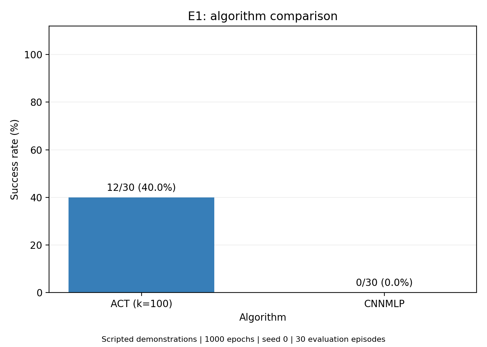
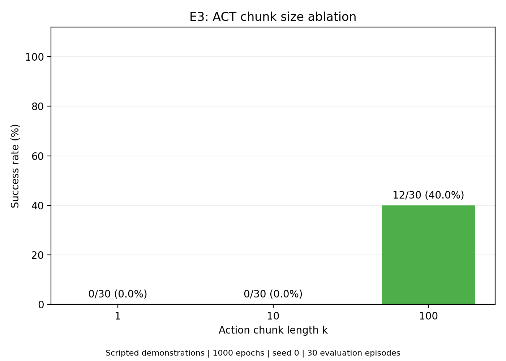

# GitHub 发布内容说明

本目录发布本次 E1、E3 快速复现的代码与轻量结果：程序化示范、训练 1000 轮、训练种子 0、每模型评估 30 回合。

| 模型 | 成功回合 | 成功率 | 平均回报 |
|---|---:|---:|---:|
| ACT k=100 | 12/30 | 40% | 274.000 |
| CNNMLP | 0/30 | 0% | 0.000 |
| ACT k=1 | 0/30 | 0% | 0.000 |
| ACT k=10 | 0/30 | 0% | 42.733 |

这是单种子快速复现的实际结果，不是论文原始结果，也不是论文所有实验的完整复现。

## 阅读入口

- [中文实验报告](reports/final_report.md)
- [汇总表](reports/summary.csv)
- [120 回合逐回合结果](reports/episode_level_results.csv)
- [配置与校验和清单](reports/experiment_manifest.csv)
- [完整性检查](reports/integrity_check.json)
- [本次服务器运行的完成记录](finish.txt)
- [E1 算法对比图](figures/E1_algorithm_comparison.png)
- [E3 动作块长度消融图](figures/E3_chunk_size_ablation.png)

## 上传内容与服务器保留内容

发布实验脚本、报告、CSV、实际训练指标 JSON、训练/评估日志、配置和损失曲线，以及 environment/ 下的现有环境清单。
每个新增文件小于 1 MiB；运行 `python E1_results/scripts/check_git_upload.py` 可检查 Git 暂存区。

原始 HDF5 数据、所有检查点、归一化统计 pickle、视频、安装缓存和大体积资源采样日志均仅保留在原服务器，未上传 GitHub。
原始仓库已跟踪的 MuJoCo XML/STL 资产保留。

报告、finish.txt、运行状态和清单原样保留，其中绝对路径是原服务器的审计记录。
本说明使用仓库相对链接。`finish.txt` 证明本次服务器运行已完成，不表示克隆仓库后自动具备权重、数据或视频。
由于权重和归一化统计未发布，克隆仓库后不能直接运行已训练策略；需要自行准备数据、环境、检查点及对应统计文件。

## 复现和后端说明

训练调用仓库官方代码。运行前先配置 constants.py 的 DATA_DIR；现有记录中的路径属于原服务器。
脚本位于 scripts/，实际训练配置与划分位于 models/ 各模型目录，评估配置和原始结果位于 evaluations/ 各模型目录。
backups/imitate_episodes.py.original 是包装器实际依赖的执行前官方源码备份。

按本次流程，先运行 preflight.py，再由 run_training_jobs.py 完成短测试、测速和正式训练。
run_accelerated_evaluations.py 用于迁移本次已运行的顺序评估，不是全新克隆后直接启动的入口。
每次新运行应使用独立目录，避免覆盖本仓库的已完成记录。

本次评估采用 OSMesa softpipe、仅渲染模型使用的顶部相机、最多三个模型独立并行。
相机过滤通过像素、状态、奖励及 RNG 一致性短测试；旧 M1 部分评估单独保留，新 M1 从 0 完成 30 回合并核对旧回合指标。
EGL 因容器缺少 graphics 能力和图形库未启用，参见 [实际检查与启用条件](reports/egl_enablement.md)。
